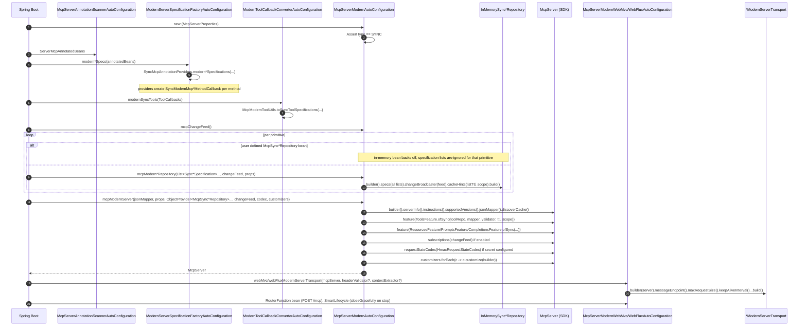
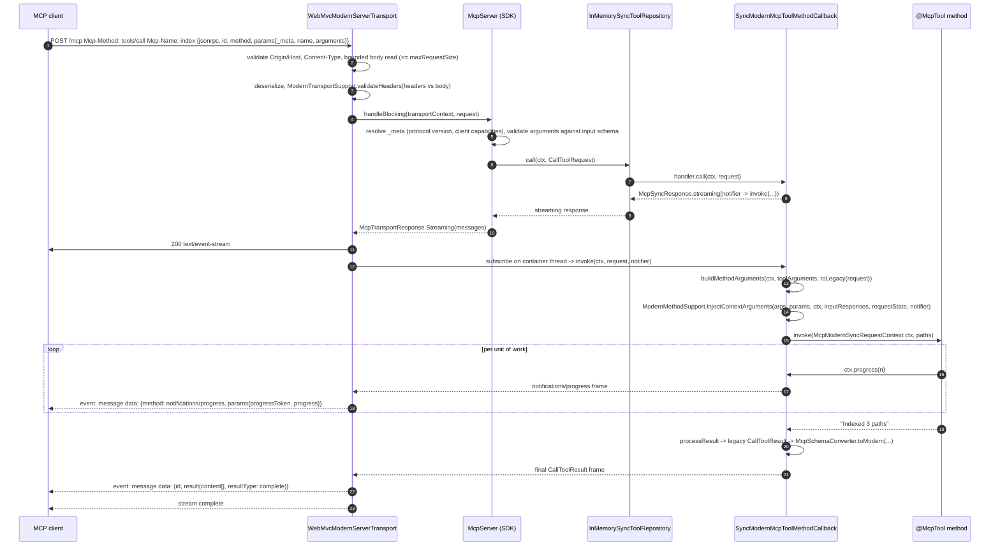
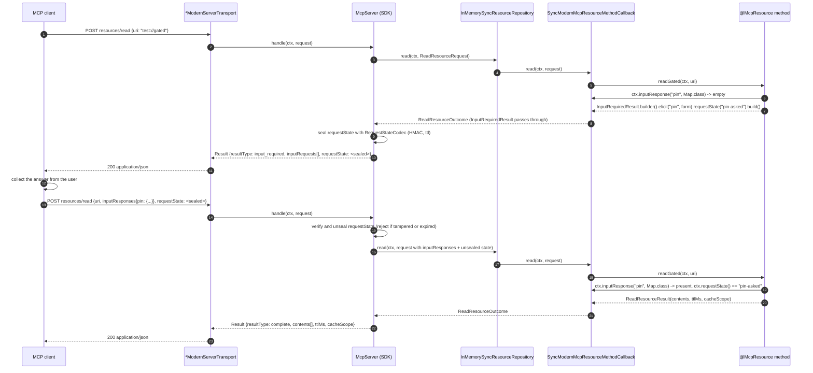
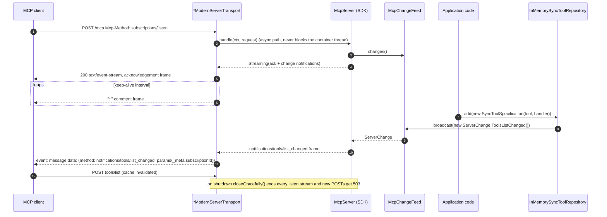
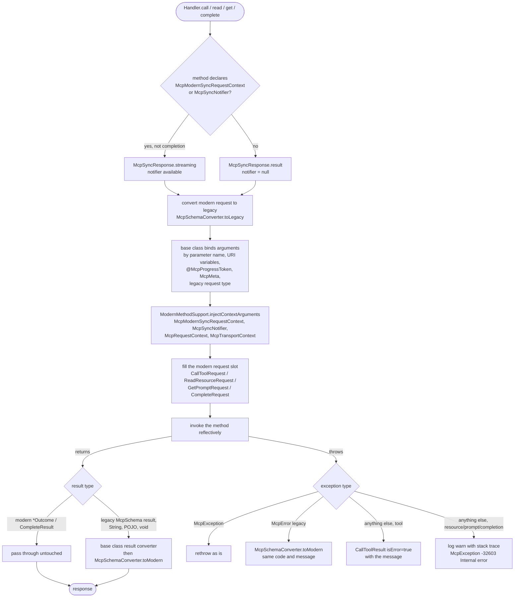
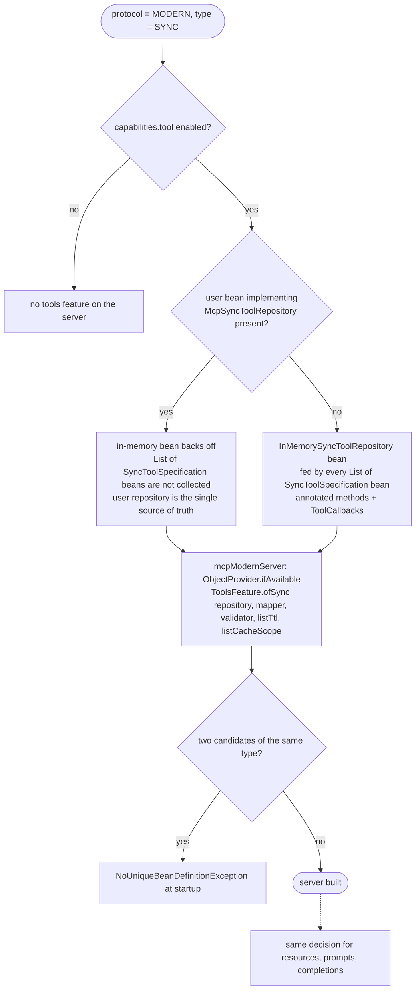

# Spring AI integration for the MCP 2026-07-28 ("modern") server

This document describes how Spring AI exposes `@McpTool`, `@McpResource`, `@McpPrompt`, `@McpComplete` methods and `ToolCallback` beans through the MCP Java SDK's `io.modelcontextprotocol.modern` server, selected with `spring.ai.mcp.server.protocol=MODERN`. Status, backlog and decision log live in [MODERN-INTEGRATION-PLAN.md](MODERN-INTEGRATION-PLAN.md). Migration guidance for existing servers is in [MODERN-MIGRATION-PATHS.md](MODERN-MIGRATION-PATHS.md); the annotation gap analysis against the 2026-07-28 revision is in [ANNOTATIONS-GAP-ANALYSIS.md](ANNOTATIONS-GAP-ANALYSIS.md).

The diagrams are Mermaid and render on GitHub and in most IDEs.

## 1. What the modern protocol changes

| Aspect | Session-based servers (STREAMABLE, STATELESS) | Modern server (2026-07-28) |
|---|---|---|
| Handshake | `initialize` + session id | None. `server/discover` is cacheable; every request carries `_meta.protocolVersion` and `_meta.clientCapabilities` |
| HTTP verbs | POST, GET (SSE), DELETE | POST only. A handler that emits progress answers with a short-lived `text/event-stream` |
| Server-initiated input | `ctx.elicit(...)`, `ctx.sample(...)`, `ctx.roots()` over the session | Multi round-trip request (MRTR): the handler returns `InputRequiredResult`; the client retries with `inputResponses` and the server-sealed `requestState` |
| Notifications | Per-session | `subscriptions/listen` stream backed by `McpChangeFeed` |
| Logging, ping | `logging/setLevel` + `notifications/message`, `ping` | `ping` removed. Logging deprecated but live: the client sets `_meta.logLevel` per request and the server may send `notifications/message` on that request's stream before the result (`McpModernSyncRequestContext.log*`, silent unless the client set the level) |
| Cache hints | None | `ttlMs` / `cacheScope` on `server/discover`, list results and `ReadResourceResult` |

Spring AI keeps one programming model across all three protocols. A method keeps its legacy `McpSchema` parameter and return types, and the modern path converts them at the boundary. The conversion is a floor, not a ceiling: each primitive also accepts the modern request, context and `*Outcome` types directly, and those pass through untouched.

## 2. Module layout

| Module | Package | Contents |
|---|---|---|
| `spring-ai-mcp` (`mcp/common`) | `org.springframework.ai.mcp.modern` | `Sync*Specification` records, `AbstractSync*Repository` bases and `InMemorySync*Repository` implementations of the SDK repository interfaces, `RepositoryOptions`, `McpSchemaConverter` (legacy ↔ modern), `McpModernToolUtils` (`ToolCallback` → specification) |
| `spring-ai-mcp-annotations` | `...annotation.context` | `McpModernSyncRequestContext` and its default implementation |
| | `...annotation.common` | `ModernMethodSupport`: parameter rules, context injection, error translation shared by the callbacks |
| | `...annotation.method.{tool,resource,prompt,complete}` | `SyncModernMcp*MethodCallback`: one per primitive, implements the matching specification `Handler` |
| | `...annotation.provider.*` | `SyncModernMcp*Provider`: scan beans and build specifications |
| | `...annotation.spring` | `SyncMcpAnnotationProviders.modern*Specifications(...)` entry points |
| `mcp-spring-webmvc`, `mcp-spring-webflux` | `...server.webmvc.transport`, `...server.webflux.transport.modern` | `WebMvcModernServerTransport` (+ package-private `ModernTransportSupport`), `WebFluxMcpTransport` (contributed by Dariusz Jędrzejczyk, self-contained) |
| `spring-ai-autoconfigure-mcp-server-common` | `...server.common.autoconfigure` | `McpServerModernAutoConfiguration`, `ModernToolCallbackConverterAutoConfiguration`, `ModernServerSpecificationFactoryAutoConfiguration`, `McpServerModernProperties` |
| `spring-ai-autoconfigure-mcp-server-{webmvc,webflux}` | `...server.{webmvc,webflux}.autoconfigure` | `McpServerModernWebMvcAutoConfiguration`, `McpServerModernWebFluxAutoConfiguration` |

## 3. Class diagrams

### 3.1 Specifications and repositories

The SDK server pulls primitives from repository interfaces. Spring AI contributes list-backed, mutable implementations and a specification record per primitive that pairs the schema object with a handler.

```mermaid
classDiagram
    direction TB

    class McpSyncToolRepository {
        <<SDK interface>>
        +list(ctx, cursor) ToolsPage
        +find(ctx, name) Tool
        +call(ctx, request) McpSyncResponse~CallToolOutcome~
    }
    class McpSyncResourceRepository {
        <<SDK interface>>
        +list(ctx, cursor) ResourcesPage
        +listTemplates(ctx, cursor) ResourceTemplatesPage
        +read(ctx, request) McpSyncResponse~ReadResourceOutcome~
        +supportsSubscribe() boolean
    }
    class McpSyncPromptRepository {
        <<SDK interface>>
        +list(ctx, cursor) PromptsPage
        +get(ctx, request) McpSyncResponse~GetPromptOutcome~
    }
    class McpSyncCompletionRepository {
        <<SDK interface>>
        +complete(ctx, request) CompleteResult
    }

    class AbstractSyncToolRepository {
        <<abstract>>
        #lookup(ctx, name)* SyncToolSpecification
        #specifications(ctx)* List
        #listTtlMs(ctx) Long
        #listCacheScope(ctx) CacheScope
        #broadcastListChanged()
    }
    class AbstractSyncResourceRepository {
        <<abstract>>
        #lookup(ctx, uri)* SyncResourceSpecification
        #specifications(ctx)* List
        #templateSpecifications(ctx)* List
        #matchTemplate(ctx, uri) SyncResourceTemplateSpecification
        #broadcastListChanged()
        #broadcastResourceUpdated(uri)
    }
    class AbstractSyncPromptRepository {
        <<abstract>>
        #lookup(ctx, name)* SyncPromptSpecification
        #specifications(ctx)* List
        #broadcastListChanged()
    }
    class RepositoryOptions {
        <<record>>
        +McpChangeBroadcaster changeBroadcaster
        +Integer pageSize
        +Long ttlMs
        +CacheScope cacheScope
    }

    class InMemorySyncToolRepository {
        +add(SyncToolSpecification)
        +remove(name) boolean
        +tools() List~Tool~
        +builder()$ Builder
    }
    class InMemorySyncResourceRepository {
        +add(SyncResourceSpecification)
        +add(SyncResourceTemplateSpecification)
        +remove(uri) boolean
        +resourceUpdated(uri)
        +builder()$ Builder
    }
    class InMemorySyncPromptRepository {
        +add(SyncPromptSpecification)
        +remove(name) boolean
        +builder()$ Builder
    }
    class InMemorySyncCompletionRepository {
        +add(SyncCompletionSpecification)
        +builder()$ Builder
    }

    class SyncToolSpecification {
        <<record>>
        +Tool tool
        +Handler handler
    }
    class SyncResourceSpecification {
        <<record>>
        +Resource resource
        +Handler handler
    }
    class SyncResourceTemplateSpecification {
        <<record>>
        +ResourceTemplate resourceTemplate
        +SyncResourceSpecification.Handler handler
    }
    class SyncPromptSpecification {
        <<record>>
        +Prompt prompt
        +Handler handler
    }
    class SyncCompletionSpecification {
        <<record>>
        +CompleteReference reference
        +Handler handler
    }

    McpSyncToolRepository <|.. AbstractSyncToolRepository
    McpSyncResourceRepository <|.. AbstractSyncResourceRepository
    McpSyncPromptRepository <|.. AbstractSyncPromptRepository
    AbstractSyncToolRepository <|-- InMemorySyncToolRepository
    AbstractSyncResourceRepository <|-- InMemorySyncResourceRepository
    AbstractSyncPromptRepository <|-- InMemorySyncPromptRepository
    McpSyncCompletionRepository <|.. InMemorySyncCompletionRepository
    AbstractSyncToolRepository --> RepositoryOptions
    AbstractSyncResourceRepository --> RepositoryOptions
    AbstractSyncPromptRepository --> RepositoryOptions

    InMemorySyncToolRepository o-- "*" SyncToolSpecification
    InMemorySyncResourceRepository o-- "*" SyncResourceSpecification
    InMemorySyncResourceRepository o-- "*" SyncResourceTemplateSpecification
    InMemorySyncPromptRepository o-- "*" SyncPromptSpecification
    InMemorySyncCompletionRepository o-- "*" SyncCompletionSpecification
```



The tool, resource and prompt repositories come in two layers. `AbstractSync{Tool,Resource,Prompt}Repository` implement the SDK interface on top of `Sync*Specification`s: they provide `*/list` paging with opaque key cursors (`RepositoryOptions.pageSize`, unset = one page and any cursor is `-32602`), the `ttlMs`/`cacheScope` list cache hints (overridable per request via `listTtlMs(ctx)`/`listCacheScope(ctx)`), dispatch to the specification handler, URI template matching for resources (`matchTemplate`, matchers compiled once per template) and the `broadcastListChanged()`/`broadcastResourceUpdated(uri)` helpers. The only abstract methods are `lookup(ctx, key)` and `specifications(ctx)` (plus `templateSpecifications(ctx)` for resources); both receive the `McpRequestContext`, so a custom repository can be tenant- or role-aware by filtering on the transport context.

`InMemorySync*Repository` are the map-backed, final subclasses used by the auto-configuration: every caller sees everything, and `add`/`remove`/`resourceUpdated(uri)` broadcast the matching change event. The completion repository has no abstract layer; its interface is a single method.

```java
public class TenantToolRepository extends AbstractSyncToolRepository {
    TenantToolRepository(McpChangeFeed feed) {
        super(RepositoryOptions.defaults().withChangeBroadcaster(feed).withPageSize(50));
    }
    @Override protected SyncToolSpecification lookup(McpRequestContext ctx, String name) { /* per tenant */ }
    @Override protected List<SyncToolSpecification> specifications(McpRequestContext ctx) { /* per tenant */ }
    @Override protected CacheScope listCacheScope(McpRequestContext ctx) { return CacheScope.PRIVATE; }
}
```

How the server consumes them, and the two helpers at the legacy/modern boundary:


Handler signatures, one per specification:

| Specification | `Handler` method |
|---|---|
| `SyncToolSpecification` | `McpSyncResponse<CallToolOutcome> call(McpRequestContext, CallToolRequest)` |
| `SyncResourceSpecification` | `McpSyncResponse<ReadResourceOutcome> read(McpRequestContext, ReadResourceRequest)` |
| `SyncPromptSpecification` | `McpSyncResponse<GetPromptOutcome> get(McpRequestContext, GetPromptRequest)` |
| `SyncCompletionSpecification` | `CompleteResult complete(McpRequestContext, CompleteRequest)` |

### 3.2 Annotation callbacks and providers

Each modern callback extends the existing abstract callback of its primitive to reuse argument binding and result conversion, and implements the matching specification `Handler`. The modern-only concerns live in `ModernMethodSupport`.

```mermaid
classDiagram
    direction TB

    class ModernMethodSupport {
        <<utility>>
        +isStreamingParameter(Class)$ boolean
        +isContextParameter(Class)$ boolean
        +rejectLegacyContextParameter(Class, Method)$
        +injectContextArguments(args, params, ctx, inputResponses, requestState, notifier)$
        +translate(Throwable, primitive, Method, bean)$ McpException
    }

    class McpModernSyncRequestContext {
        <<interface>>
        +context() McpRequestContext
        +protocolVersion() String
        +clientCapabilities() ClientCapabilities
        +clientInfo() Implementation
        +requestMeta() Map
        +transportContext() McpTransportContext
        +progressToken() Object
        +isRetry() boolean
        +inputResponses() Map
        +inputResponse(key, type) Optional~T~
        +requestState() String
        +progressEnabled() boolean
        +progress(int)
        +progress(double, total, message)
        +notify(method, params)
    }
    class DefaultMcpModernSyncRequestContext {
        -McpRequestContext context
        -McpSyncNotifier notifier
        +builder()$ Builder
    }
    DefaultMcpModernSyncRequestContext ..|> McpModernSyncRequestContext

    class AbstractMcpToolMethodCallback~T, RC~ {
        #buildMethodArguments(ctx, args, legacyRequest) Object[]
        #convertValueToCallToolResult(Object) CallToolResult
        #isExchangeOrContextType(Class)* boolean
    }
    class AbstractSyncMcpToolMethodCallback~T, RC~ {
        #processResult(Object) CallToolResult
        #createSyncErrorResult(Exception) CallToolResult
    }
    class AbstractMcpResourceMethodCallback {
        #buildArgsWithUriVariables(...)
        #buildArgsWithoutUriVariables(...)
        #validateReturnType(Method)
    }
    class AbstractMcpPromptMethodCallback {
        #buildArgs(ctx, legacyRequest) Object[]
        #validateMethod(Method)
    }
    class AbstractMcpCompleteMethodCallback {
        #buildArgs(ctx, legacyRequest) Object[]
    }

    class SyncModernMcpToolMethodCallback {
        -boolean streaming
        +call(ctx, CallToolRequest) McpSyncResponse~CallToolOutcome~
        +isModernInfrastructureParameter(Class)$ boolean
    }
    class SyncModernMcpResourceMethodCallback {
        -boolean streaming
        +read(ctx, ReadResourceRequest) McpSyncResponse~ReadResourceOutcome~
        +builder()$ Builder
    }
    class SyncModernMcpPromptMethodCallback {
        -boolean streaming
        +get(ctx, GetPromptRequest) McpSyncResponse~GetPromptOutcome~
    }
    class SyncModernMcpCompleteMethodCallback {
        +complete(ctx, CompleteRequest) CompleteResult
    }

    AbstractSyncMcpToolMethodCallback --|> AbstractMcpToolMethodCallback
    SyncModernMcpToolMethodCallback --|> AbstractSyncMcpToolMethodCallback
    SyncModernMcpResourceMethodCallback --|> AbstractMcpResourceMethodCallback
    SyncModernMcpPromptMethodCallback --|> AbstractMcpPromptMethodCallback
    SyncModernMcpCompleteMethodCallback --|> AbstractMcpCompleteMethodCallback

    SyncModernMcpToolMethodCallback ..|> SyncToolSpecification_Handler
    SyncModernMcpResourceMethodCallback ..|> SyncResourceSpecification_Handler
    SyncModernMcpPromptMethodCallback ..|> SyncPromptSpecification_Handler
    SyncModernMcpCompleteMethodCallback ..|> SyncCompletionSpecification_Handler

    class SyncToolSpecification_Handler { <<interface>> }
    class SyncResourceSpecification_Handler { <<interface>> }
    class SyncPromptSpecification_Handler { <<interface>> }
    class SyncCompletionSpecification_Handler { <<interface>> }

    SyncModernMcpToolMethodCallback ..> ModernMethodSupport
    SyncModernMcpResourceMethodCallback ..> ModernMethodSupport
    SyncModernMcpPromptMethodCallback ..> ModernMethodSupport
    SyncModernMcpCompleteMethodCallback ..> ModernMethodSupport
    ModernMethodSupport ..> DefaultMcpModernSyncRequestContext : builds
    ModernMethodSupport ..> McpSchemaConverter : McpError to McpException

    class SyncModernMcpToolProvider {
        +getToolSpecifications() List~SyncToolSpecification~
    }
    class SyncModernMcpResourceProvider {
        +getModernResourceSpecifications() List
        +getModernResourceTemplateSpecifications() List
    }
    class SyncModernMcpPromptProvider {
        +getModernPromptSpecifications() List
    }
    class SyncModernMcpCompleteProvider {
        +getModernCompleteSpecifications() List
    }
    class SyncMcpAnnotationProviders {
        <<utility>>
        +modernToolSpecifications(beans)$
        +modernResourceSpecifications(beans)$
        +modernResourceTemplateSpecifications(beans)$
        +modernPromptSpecifications(beans)$
        +modernCompleteSpecifications(beans)$
    }
    SyncMcpAnnotationProviders ..> SyncModernMcpToolProvider
    SyncMcpAnnotationProviders ..> SyncModernMcpResourceProvider
    SyncMcpAnnotationProviders ..> SyncModernMcpPromptProvider
    SyncMcpAnnotationProviders ..> SyncModernMcpCompleteProvider
    SyncModernMcpToolProvider ..> SyncModernMcpToolMethodCallback : creates
    SyncModernMcpResourceProvider ..> SyncModernMcpResourceMethodCallback : creates
    SyncModernMcpPromptProvider ..> SyncModernMcpPromptMethodCallback : creates
    SyncModernMcpCompleteProvider ..> SyncModernMcpCompleteMethodCallback : creates
```



Parameter and return types accepted by every modern callback, on top of the legacy ones:

| Primitive | Injected parameters | Pass-through return types |
|---|---|---|
| `@McpTool` | `McpModernSyncRequestContext`, `McpRequestContext`, `McpSyncNotifier`, `McpTransportContext`, modern `CallToolRequest` | `CallToolOutcome` (`CallToolResult`, `InputRequiredResult`) |
| `@McpResource` | same, plus modern `ReadResourceRequest` | `ReadResourceOutcome` (`ReadResourceResult` with `ttlMs`/`cacheScope`, `InputRequiredResult`) |
| `@McpPrompt` | same, plus modern `GetPromptRequest` | `GetPromptOutcome` (`GetPromptResult`, `InputRequiredResult`) |
| `@McpComplete` | `McpModernSyncRequestContext`, `McpRequestContext`, `McpTransportContext`, modern `CompleteRequest` (no notifier: completions are plain results) | `CompleteResult` |

`@McpResource` has two modern-only attributes, `ttlMs` (default `0`, not cacheable) and `cacheScope` (default `PRIVATE`). `SyncModernMcpResourceProvider` passes them to the callback, which stamps them on every *converted* legacy result. A method that returns a modern `ReadResourceResult` keeps its own hints and the attributes are ignored. The legacy providers (`SyncMcpResourceProvider` and friends) log a warning via `McpResourceCacheHints.warnIfIgnored` when the attributes are set, because the legacy `resources/read` result has no field for them.

```java
@McpResource(uri = "catalog://products", ttlMs = 60_000, cacheScope = CacheScope.PUBLIC)
String products() { ... }   // served with ttlMs=60000, cacheScope=public
```

Declaring `McpModernSyncRequestContext` or `McpSyncNotifier` makes the response streaming. The legacy `McpSyncServerExchange` and `McpSyncRequestContext` are rejected (callback) or skipped with a warning (provider), because there is no session to call back on.

### 3.3 Auto-configuration and transports

```mermaid
classDiagram
    direction TB

    class McpServerProperties {
        +protocol : STREAMABLE | STATELESS | MODERN
        +type : SYNC | ASYNC
        +name, version, instructions
        +capabilities.tool/resource/prompt/completion
    }
    class McpServerModernProperties {
        +mcpEndpoint = "/mcp"
        +supportedVersions
        +discoverTtl, discoverCacheScope
        +listTtl, listCacheScope
        +keepAliveInterval
        +maxRequestSize = 16MB
        +requestStateSecret, requestStateTtl
        +subscriptions, resourceSubscribe
    }

    class ModernServerSpecificationFactoryAutoConfiguration {
        +modernToolSpecs(ServerMcpAnnotatedBeans) List~SyncToolSpecification~
        +modernResourceSpecs(...) List~SyncResourceSpecification~
        +modernResourceTemplateSpecs(...) List
        +modernPromptSpecs(...) List~SyncPromptSpecification~
        +modernCompletionSpecs(...) List~SyncCompletionSpecification~
    }
    class ModernToolCallbackConverterAutoConfiguration {
        +modernSyncTools(ObjectProvider~List~ToolCallback~~) List~SyncToolSpecification~
    }
    class McpServerModernAutoConfiguration {
        +mcpChangeFeed() McpChangeFeed
        +mcpModernToolRepository(...) InMemorySyncToolRepository
        +mcpModernResourceRepository(...) InMemorySyncResourceRepository
        +mcpModernPromptRepository(...) InMemorySyncPromptRepository
        +mcpModernCompletionRepository(...) InMemorySyncCompletionRepository
        +mcpModernServer(...) McpServer
        +mcpModernStdioTransport(...) StdioMcpTransport
    }
    class McpModernServerCustomizer {
        <<interface>>
        +customize(McpServer.Builder)
    }
    class McpServerModernWebMvcAutoConfiguration {
        +webMvcModernServerTransport(McpServer, ...) WebMvcModernServerTransport
        +webMvcModernServerRouterFunction(transport) RouterFunction
        +webMvcModernServerTransportLifecycle(transport) SmartLifecycle
    }
    class McpServerModernWebFluxAutoConfiguration {
        +webFluxMcpTransport(McpServer, ...) WebFluxMcpTransport
        +webFluxModernServerRouterFunction(transport) RouterFunction
        +webFluxMcpTransportLifecycle(transport) SmartLifecycle
    }

    class WebMvcModernServerTransport {
        -McpRequestManager requestManager
        -int requestMaxSize
        -ServerHttpHeaderValidator httpHeaderValidator
        -McpTransportContextExtractor contextExtractor
        +getRouterFunction() RouterFunction
        +closeGracefully() Mono~Void~
        -handlePost(ServerRequest) ServerResponse
        -streamOnContainerThread(...)
        -streamOverAsyncContext(...)
    }
    class WebFluxMcpTransport {
        -McpRequestManager requestManager
        -int maxRequestSize
        -ServerHttpHeaderValidator httpHeaderValidator
        +getRouterFunction() RouterFunction
        +closeGracefully() void
        -handlePost(ServerRequest) Mono~ServerResponse~
        -events(Flux~JSONRPCMessage~) Flux~ServerSentEvent~
        -validateHeaders(request, JSONRPCRequest)$ String
    }
    class ModernTransportSupport {
        <<package-private, WebMvc module>>
        +validateHeaders(headers, JSONRPCRequest)$ String
        +statusFor(errorStatuses, JSONRPCResponse)$ int
        +frames(messages, keepAlive)$ Flux
        +headerAccessor(ServerRequest)$ HeaderAccessor
    }

    McpServerModernAutoConfiguration ..> McpServerProperties
    McpServerModernAutoConfiguration ..> McpServerModernProperties
    McpServerModernAutoConfiguration ..> McpModernServerCustomizer : applies all
    ModernServerSpecificationFactoryAutoConfiguration ..> SyncMcpAnnotationProviders
    ModernToolCallbackConverterAutoConfiguration ..> McpModernToolUtils
    ModernServerSpecificationFactoryAutoConfiguration --> McpServerModernAutoConfiguration : List beans feed in-memory repositories
    ModernToolCallbackConverterAutoConfiguration --> McpServerModernAutoConfiguration : List beans feed in-memory repositories
    McpServerModernAutoConfiguration --> McpServer : builds
    McpServerModernWebMvcAutoConfiguration --> WebMvcModernServerTransport : builds from McpServer
    McpServerModernWebFluxAutoConfiguration --> WebFluxMcpTransport : builds from McpServer
    WebMvcModernServerTransport ..> ModernTransportSupport
    WebMvcModernServerTransport --> McpServer : handleBlocking / handle
    WebFluxMcpTransport --> McpServer : handle
```



Conditions, in order of evaluation:

- All modern auto-configurations require `McpServer` on the classpath, `spring.ai.mcp.server.enabled` not `false`, and `protocol=MODERN`.
- `McpServerModernAutoConfiguration` asserts `type=SYNC` in its constructor and fails the context otherwise, instead of starting with no server.
- Each in-memory repository bean is `@ConditionalOnMissingBean` on the SDK interface for that primitive and on the matching `capabilities.*` property.
- The `McpServer` bean is `@ConditionalOnMissingBean`; the stdio transport is created only with `stdio=true`.

## 4. Sequence diagrams

### 4.1 Startup wiring



### 4.2 `tools/call` with progress (WebMvc)



A method without a streaming parameter follows the same path but answers `McpSyncResponse.result(...)` and the transport writes a single `application/json` response.

### 4.3 Multi round-trip request (resource read)



The same flow applies to `tools/call` (`CallToolOutcome`) and `prompts/get` (`GetPromptOutcome`). The SDK only accepts `InputRequiredResult` from features that declare MRTR support, which the Spring AI features do.

### 4.4 `subscriptions/listen` and a runtime change



`InMemorySyncResourceRepository.resourceUpdated(uri)` broadcasts `notifications/resources/updated` the same way, when `resource-subscribe=true` advertises the capability.

## 5. Activity diagrams

### 5.1 Transport request handling (WebMvc and WebFlux)


### 5.2 Modern method callback invocation



Validation at construction time, per callback: at most one parameter of each injected type, legacy `McpSyncServerExchange`/`McpSyncRequestContext` rejected with a message naming the replacement, `McpSyncNotifier` rejected on completion methods, return type must be a legacy type or the primitive's modern `*Outcome`.

### 5.3 Repository selection at auto-configuration



## 6. Properties

| Property | Default | Purpose |
|---|---|---|
| `spring.ai.mcp.server.protocol` | `STREAMABLE` | `MODERN` selects this integration |
| `spring.ai.mcp.server.type` | `SYNC` | Only `SYNC` is supported; `ASYNC` fails startup |
| `spring.ai.mcp.server.modern.mcp-endpoint` | `/mcp` | POST endpoint |
| `spring.ai.mcp.server.modern.supported-versions` | `2026-07-28` | Versions accepted in `_meta` and advertised by `server/discover` |
| `spring.ai.mcp.server.modern.discover-ttl` / `discover-cache-scope` | `0` / `PRIVATE` | `server/discover` cache hints |
| `spring.ai.mcp.server.modern.list-ttl` / `list-cache-scope` | `0` / `PRIVATE` | `*/list` cache hints |
| `spring.ai.mcp.server.modern.page-size` | unset | Entries per `*/list` page of the in-memory repositories; unset = single page |
| `spring.ai.mcp.server.modern.keep-alive-interval` | `30s` | SSE comment interval on streams |
| `spring.ai.mcp.server.modern.max-request-size` | `16MB` | Enforced by the transports while reading the body |
| `spring.ai.mcp.server.modern.request-state-secret` / `request-state-ttl` | unset / SDK default | HMAC sealing of MRTR `requestState`; set the secret on every instance behind a load balancer |
| `spring.ai.mcp.server.modern.subscriptions` | `true` | Serve `subscriptions/listen` |
| `spring.ai.mcp.server.modern.resource-subscribe` | `false` | Advertise `resources.subscribe` |

## 7. Extension points

| Bean type | Effect |
|---|---|
| `McpSyncToolRepository`, `McpSyncResourceRepository`, `McpSyncPromptRepository`, `McpSyncCompletionRepository` | Replaces the in-memory repository for that primitive |
| `McpModernServerCustomizer` | Receives the `McpServer.Builder` before `build()` |
| `RequestStateCodec` | Replaces the HMAC codec built from the properties |
| `ServerHttpHeaderValidator` | Origin and Host validation on every POST |
| `McpTransportContextExtractor<ServerRequest>` | Derives the `McpTransportContext` handlers see |
| `List<SyncToolSpecification>` etc. | Extra specifications merged into the in-memory repositories |
| `InMemorySync*Repository` injection | Runtime `add`/`remove`/`resourceUpdated`, broadcast to listeners |

## 8. Known trade-offs

- The WebMvc module keeps a package-private `ModernTransportSupport` copy of private helpers of the SDK's `HttpServletMcpTransport`; the WebFlux transport (`WebFluxMcpTransport`, from Dariusz Jędrzejczyk's `modern-webflux-transport` branch) is self-contained and duplicates the same header-validation logic. Both are meant to be replaced by an SDK-provided helper.
- `McpSchemaConverter` uses `McpJsonDefaults.getMapper()` rather than the configured `mcpServerJsonMapper` bean.
- The integration builds against the SDK `2.2.0-SNAPSHOT`; release is gated on the SDK release.
- `ASYNC` API type and an MRTR helper DSL are not implemented yet.
