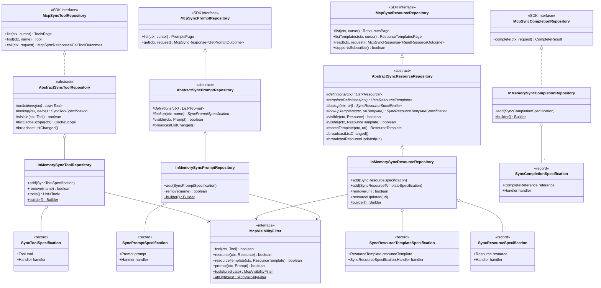
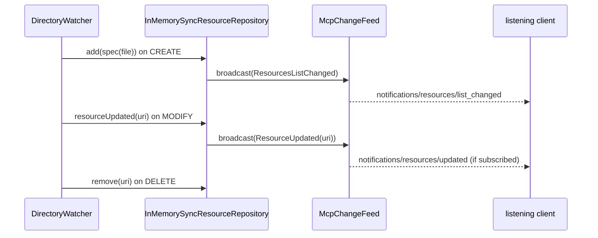
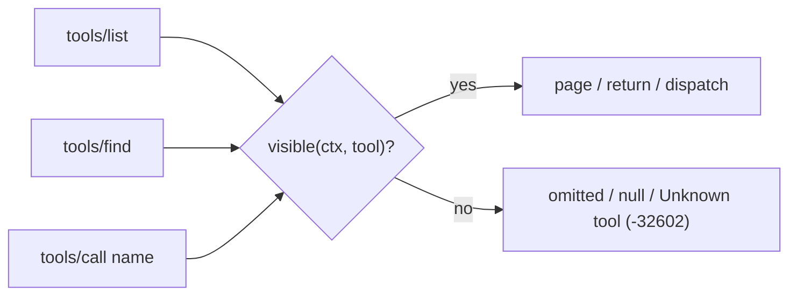
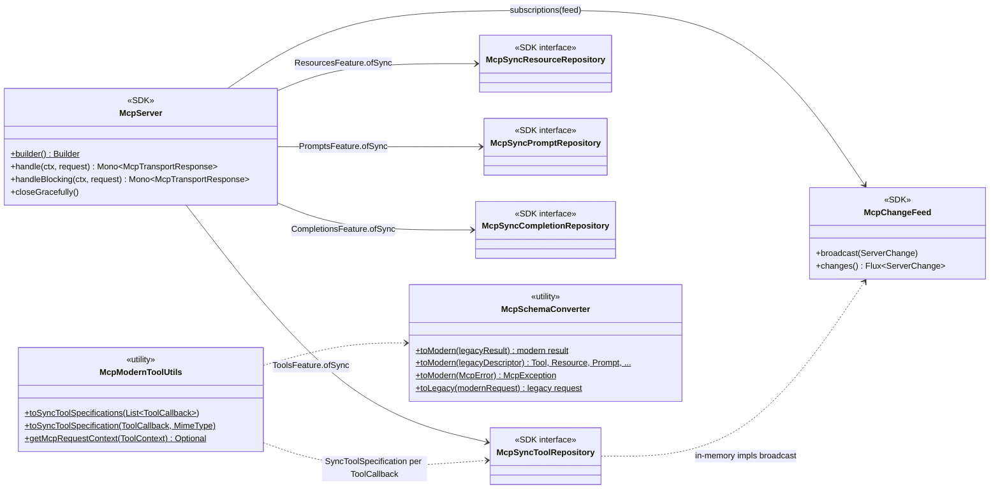
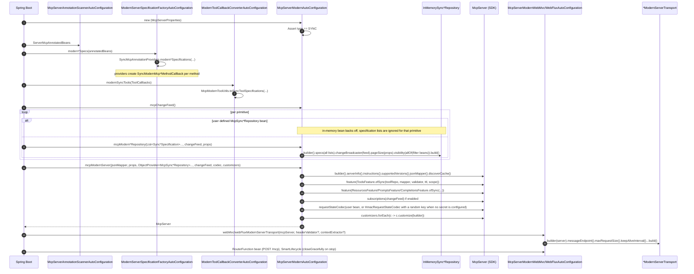
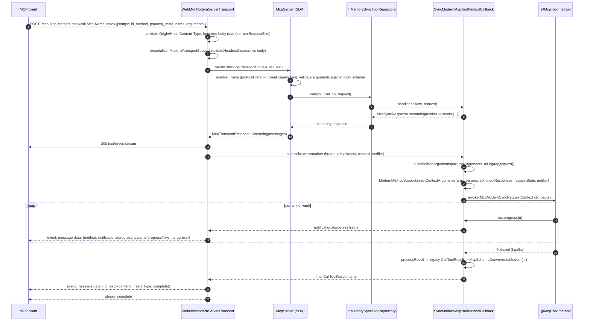
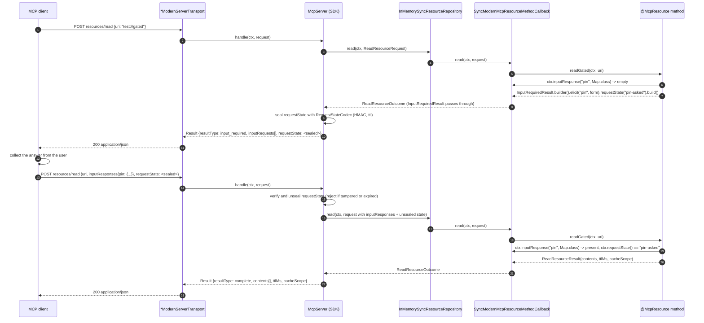
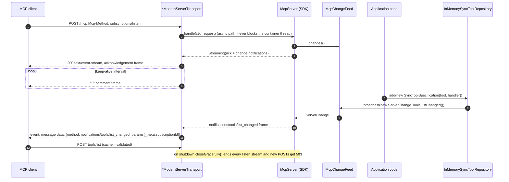
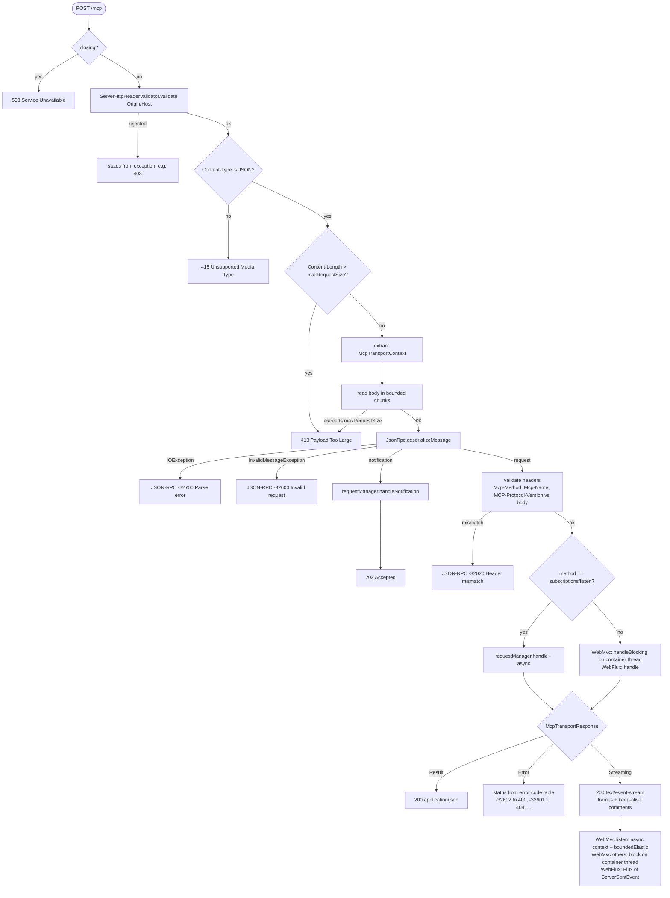

# Spring AI integration for the MCP 2026-07-28 ("modern") server

The Spring AI MCP server support for the link:https://modelcontextprotocol.io/specification/2026-07-28[MCP 2026-07-28 specification revision] (referred to as the "modern" protocol) exposes `@McpTool`, `@McpResource`, `@McpPrompt` and `@McpComplete` methods, as well as `ToolCallback` beans, through the `io.modelcontextprotocol.modern` server of the MCP Java SDK.
It is enabled with `spring.ai.mcp.server.protocol=MODERN`.

This document describes the design: the protocol changes, the module layout, the class, sequence and activity diagrams, the configuration properties and the extension points.
The delivery status, the backlog, the design decisions and the accepted trade-offs are maintained in [MODERN-INTEGRATION-PLAN.md](MODERN-INTEGRATION-PLAN.md).
Guidance for migrating an existing server is provided in [MODERN-MIGRATION-PATHS.md](MODERN-MIGRATION-PATHS.md).

NOTE: The diagrams use Mermaid syntax and render on GitHub and in most IDEs.

## 1. What the modern protocol changes

| Aspect | Session-based servers (STREAMABLE, STATELESS) | Modern server (2026-07-28) |
|---|---|---|
| Handshake | `initialize` + session id | None. `server/discover` is cacheable; every request carries `_meta.protocolVersion` and `_meta.clientCapabilities` |
| HTTP verbs | POST, GET (SSE), DELETE | POST only. A handler that emits progress answers with a short-lived `text/event-stream` |
| Server-initiated input | `ctx.elicit(...)`, `ctx.sample(...)`, `ctx.roots()` over the session | Multi round-trip request (MRTR): the handler returns `InputRequiredResult`; the client retries with `inputResponses` and the server-sealed `requestState` |
| Notifications | Per-session | `subscriptions/listen` stream backed by `McpChangeFeed` |
| Logging, ping | `logging/setLevel` + `notifications/message`, `ping` | `ping` removed. Logging deprecated but live: the client sets `_meta.logLevel` per request and the server may send `notifications/message` on that request's stream before the result (`McpModernSyncRequestContext.log*`, silent unless the client set the level) |
| Cache hints | None | `ttlMs` / `cacheScope` on `server/discover`, list results and `ReadResourceResult` |

Spring AI keeps a single programming model across all protocols.
An annotated method can keep its legacy `McpSchema` parameter and return types, and the modern server converts them at the boundary.
The conversion is a compatibility baseline rather than a limit: every primitive also accepts the modern request, context and `*Outcome` types directly, and those are passed through to the SDK unchanged.

### 1.1 Spec coverage of the server annotations

The following table shows how the features of the 2026-07-28 revision map onto the server-side annotations (`@McpTool`, `@McpToolParam`, `@McpResource`, `@McpPrompt`, `@McpArg`, `@McpComplete`, `@McpMeta`, `@McpProgressToken`, `@McpIcon`), the `MetaProvider` hook and the `McpModernSyncRequestContext` parameter type.
The approach is additive: there is one annotation set, and every annotation keeps working on the SSE, STREAMABLE, STATELESS and MODERN servers.
The open proposals are designed in the appendices of the plan.

| # | Spec feature (SEP) | Spring AI today | Kind |
|---|---|---|---|
| 1 | MRTR: elicitation form and URL, sampling, roots (SEP-2322) | imperative: return `InputRequiredResult`, read `ctx.inputResponse(key, type)` on retry. Declarative parameter annotations designed in the plan, Appendix B | open proposal |
| 2 | `-32021 MissingRequiredClientCapability` | `ModernMethodSupport.checkClientCapabilities` inspects every `InputRequiredResult` and answers `-32021` with `requiredCapabilities` | done |
| 3 | Cache hints on `resources/read` (SEP-2549); retry results must not be cached | `@McpResource(ttlMs, cacheScope)`; the SDK's `McpServer.resultResponse` forces `ttlMs = 0`/`PRIVATE` on retries, covered by a Spring AI test | done |
| 4 | Logging per request: `_meta.logLevel` + `notifications/message` on the request stream (deprecated, SEP-2577) | `McpModernSyncRequestContext.logLevel()`, `logEnabled()`, `log(level, logger, data)`, `debug/info/warn/error`; silent unless the client set the key. Open: the SDK never advertises the `logging` capability, see the plan, Appendix C item 11 | done, SDK open |
| 5 | Progress | `McpModernSyncRequestContext.progress(...)`, `@McpProgressToken` | done |
| 6 | Icons on `Tool`, `Resource`, `ResourceTemplate`, `Prompt` | `@McpIcon` and `icons = {...}` on `@McpTool`, `@McpResource`, `@McpPrompt` | done |
| 7 | `PromptArgument.title` | `@McpArg(title = ...)` | done |
| 8 | `Resource.size` | `@McpResource(size = ...)`, `-1` = unset | done |
| 9 | `x-mcp-header` (SEP-2243) | `@McpToolParam(header = true)` emits `"x-mcp-header": "Mcp-Param-<name>"` and rejects non-primitive parameters at startup; legacy and stateless servers publish it too. Header validation against the body is a transport concern, the plan, Appendix C item 1 | done, SDK open |
| 10 | Loosened `inputSchema` / `outputSchema` (SEP-2106) | generated from Java types; `generateOutputSchema`. Hand-written schema attributes proposed in the plan, Appendix B | open, optional |
| 11 | Deterministic `tools/list` order | providers sort by method name, repositories by key | done |
| 12 | `subscriptions/listen`; `resources.subscribe` means the `resourceSubscriptions` filter is supported | server-wide `resource-subscribe` property; `InMemorySyncResourceRepository.resourceUpdated(uri)` or `broadcastResourceUpdated` in a custom repository. No per-resource opt-in exists in the protocol  | done |
| 13 | Cancellation (`notifications/cancelled`, stream close) | implicit: stream close cancels the Reactor chain. `ctx.isCancelled()` proposed in the plan, Appendix B | open, optional |
| 14 | Sampling with tools (`sampling.tools`, `tools`, `toolChoice`) | not in the SDK's modern `CreateMessageRequest` | SDK gap |
| 15 | `extensions` capability maps, `Implementation.description/websiteUrl/icons`, `server/discover.instructions` | properties and `McpModernServerCustomizer`, not annotations | adjacent |
| 16 | Tasks extension (`io.modelcontextprotocol/tasks`, SEP-2663) | not in the SDK | future |
| 17 | `McpSyncRequestContext`, `McpSyncServerExchange` parameters on MODERN | rejected at construction, skipped by providers | done |

None of the server-side annotations needs to be removed.
The operations removed by the revision (`initialize`, `ping`, `logging/setLevel`, `resources/subscribe`, `notifications/elicitation/complete` and the `elicitationId` field) affect the request context types and the client, not the annotations.

## 2. Module layout

| Module | Package | Contents |
|---|---|---|
| `spring-ai-mcp` (`mcp/common`) | `org.springframework.ai.mcp.modern` | `Sync*Specification` records, `AbstractSync*Repository` bases and `InMemorySync*Repository` implementations of the SDK repository interfaces, `McpVisibilityFilter`, `McpTransportContexts`, `McpSchemaConverter` (legacy ↔ modern), `McpModernToolUtils` (`ToolCallback` → specification) |
| `spring-ai-mcp-annotations` | `...annotation.context` | `McpModernSyncRequestContext` and its default implementation |
| | `...annotation.common` | `ModernMethodSupport`: parameter rules, context injection, error translation shared by the callbacks |
| | `...annotation.method.{tool,resource,prompt,complete}` | `SyncModernMcp*MethodCallback`: one per primitive, implements the matching specification `Handler` |
| | `...annotation.provider.*` | `SyncModernMcp*Provider`: scan beans and build specifications |
| | `...annotation.spring` | `SyncMcpAnnotationProviders.modern*Specifications(...)` entry points |
| `mcp-spring-webmvc`, `mcp-spring-webflux` | `...server.webmvc.transport`, `...server.webflux.transport.modern` | `WebMvcModernServerTransport` (+ package-private `ModernTransportSupport`), `WebFluxMcpTransport` (contributed by Dariusz Jędrzejczyk, self-contained) |
| `spring-ai-autoconfigure-mcp-server-common` | `...server.common.autoconfigure` | `McpServerModernAutoConfiguration`, `ModernToolCallbackConverterAutoConfiguration`, `ModernServerSpecificationFactoryAutoConfiguration`, `McpServerModernProperties` |
| `spring-ai-autoconfigure-mcp-server-{webmvc,webflux}` | `...server.{webmvc,webflux}.autoconfigure` | `McpServerModernWebMvcAutoConfiguration`, `McpServerModernWebFluxAutoConfiguration` |

## 3. Class diagrams

### 3.1 Specifications and repositories

The SDK server obtains its primitives from repository interfaces.
Spring AI provides mutable, map-backed implementations of these interfaces and, for each primitive, a specification record that pairs the schema definition with its handler.



The tool, resource and prompt repositories are organized in two layers.

The `AbstractSync{Tool,Resource,Prompt}Repository` base classes implement the SDK interfaces on top of three hooks:

* `definitions(ctx)` - Returns the plain definitions used for listing.
* `lookup(ctx, key)` - Returns the `Sync*Specification` (definition plus handler) used for dispatch.
* `visible(ctx, definition)` - Decides whether the caller may see a definition. The resource base has one overload for `Resource` and one for `ResourceTemplate`, and adds `templateDefinitions(ctx)` and `lookupTemplate(ctx, uriTemplate)`.

The base classes provide `*/list` paging with opaque key cursors (the constructor's `pageSize`; when unset, everything is returned on one page and any cursor is rejected with `-32602`), the list `cacheScope` (`listCacheScope(ctx)`, where `null` means the feature default from the properties), handler dispatch, URI template matching for resources (`matchTemplate`, with matchers compiled once per template) and the `broadcastListChanged()` and `broadcastResourceUpdated(uri)` helpers.
The constructor takes the change broadcaster, the page size and an optional `McpVisibilityFilter`; the resource base additionally takes the subscribe flag.

The `InMemorySync*Repository` classes are the final, map-backed subclasses used by the auto-configuration.
Their `add`, `remove` and `resourceUpdated(uri)` methods broadcast the corresponding change event to the `subscriptions/listen` clients.
The completion repository implements the single-method SDK interface directly and has no abstract layer.

There are two ways to make the visible catalogue depend on the caller.

The first option keeps the annotated catalogue and adds one or more `McpVisibilityFilter` beans.
The auto-configuration combines all filter beans with AND and applies them to the in-memory repositories:

```java
@Bean
McpVisibilityFilter adminOnlyUnlessPublic() {
    return McpVisibilityFilter.tools((ctx, tool) ->
        "admin".equals(McpTransportContexts.header(ctx, "x-role"))
            || (tool.meta() != null && "public".equals(tool.meta().get("visibility"))));
}
```

The second option replaces the catalogue with a bean that extends one of the abstract base classes and serves definitions that already depend on the caller.
Filter beans are not applied to such a repository automatically.
If they should still apply, pass them to the constructor as shown below; a non-null filter also marks the repository's listings as `cacheScope: private`.

```java
@Component
public class TenantToolRepository extends AbstractSyncToolRepository {

    private final ToolCatalog catalog;

    TenantToolRepository(ToolCatalog catalog, McpChangeFeed feed, ObjectProvider<McpVisibilityFilter> filters) {
        super(feed, 50, McpVisibilityFilter.allOf(filters.orderedStream().toList()));
        this.catalog = catalog;
    }

    @Override protected List<Tool> definitions(McpRequestContext ctx) { return catalog.toolsOf(tenant(ctx)); }

    @Override protected SyncToolSpecification lookup(McpRequestContext ctx, String name) { return catalog.find(tenant(ctx), name); }

    private String tenant(McpRequestContext ctx) { return McpTransportContexts.header(ctx, "x-tenant"); }
}
```

The next section describes the rules that both options rely on and the two scenarios they were designed for.

#### Customising the repositories

The repository layer was designed and tested against two application scenarios.

**Serving resources from the file system.**
The simplest solution does not require a custom repository.
A directory watcher calls `add`, `remove` and `resourceUpdated(uri)` on the auto-configured `InMemorySyncResourceRepository`, and the list-changed and resource-updated notifications reach the `subscriptions/listen` clients through the `McpChangeFeed`:



This approach takes about 40 lines of application code and keeps the catalogue in memory, which is suitable for trees of up to tens of thousands of files.

NOTE: The `resourceUpdated` notifications reach the clients only when `spring.ai.mcp.server.modern.resource-subscribe` is enabled.

For large or remote trees, extend `AbstractSyncResourceRepository` instead and declare the subclass as a bean.
Listing walks the tree and returns plain `Resource` records, while the handler is created only when a resource is read:

```java
@Component
public class FileSystemResourceRepository extends AbstractSyncResourceRepository {

    FileSystemResourceRepository(McpChangeFeed feed, @Value("${docs.root}") Path root) {
        super(feed, 100, true);               // broadcaster, page size, resources.subscribe
        watch(root, this::broadcastListChanged, this::broadcastResourceUpdated);
    }

    protected List<Resource> definitions(McpRequestContext ctx) {
        return walk().map(p -> Resource.builder(uriOf(p), p.getFileName().toString()).build()).toList();
    }

    protected List<ResourceTemplate> templateDefinitions(McpRequestContext ctx) { return List.of(); }

    protected SyncResourceSpecification lookup(McpRequestContext ctx, String uri) {
        Path p = resolve(uri);                // null when outside the root or missing
        return p == null ? null : new SyncResourceSpecification(Resource.builder(uri, p.getFileName().toString()).build(),
            (c, req) -> McpSyncResponse.result(ReadResourceResult.builder(List.of(contents(p, uri))).build()));
    }

    protected SyncResourceTemplateSpecification lookupTemplate(McpRequestContext ctx, String uriTemplate) { return null; }
}
```

NOTE: Listing still materialises every definition on each page request. The keyset paging hook that removes this cost is tracked as backlog item 1 in the plan (Appendix A).

**Filtering the scanned `@McpTool` methods by HTTP header.**
This scenario requires a single `McpVisibilityFilter` bean, as shown in the example above, and no custom repository or transport context extractor.
The `_meta` map of a definition is `null` unless something populated it, hence the null check; `@McpTool(metaProvider = ...)` fills it for annotated tools.
A hidden tool is not listed, a `tools/call` by name is answered with `Unknown tool` (`-32602`) exactly as for a tool that does not exist, and the listing carries `cacheScope: private`.

**Design rules.**

The following rules apply to both options:

* **One visibility hook, consulted on every path** - Each abstract base has a `visible(ctx, definition)` hook that defaults to the optional `McpVisibilityFilter` passed to the constructor. `list` filters before paging, so each caller gets a consistent key cursor over its own view; `find` returns `null` for a hidden definition; `call`, `read` and `get` answer with the same `-32602` error as for a non-existent primitive, so hiding never reveals existence. A hidden resource is not served by a resource template that matches its URI either. A filtered listing is always `cacheScope: private`, regardless of the `list-cache-scope` property, because a shared cache must never serve one caller's view to another.



* **One filter interface for all primitives** - `McpVisibilityFilter` has four default methods that return `true`, so a tenant or role rule written once covers tools, resources, resource templates and prompts. The static factories `tools(...)`, `resources(...)`, `resourceTemplates(...)` and `prompts(...)` build a single-primitive filter from a lambda, and `allOf(...)` combines several filters with AND. The auto-configuration applies every filter bean to the in-memory repositories and guards `completion/complete`, so that a reference to a prompt or template the caller cannot `find` is rejected as unknown.
* **Request headers in the transport context by default** - The WebMvc and WebFlux auto-configurations install a `HeaderTransportContextExtractor` unless an extractor bean is defined. It stores the request headers under `McpTransportContexts.HEADERS` with lower-cased names, drops the `Mcp-*` protocol headers (the request context exposes them already) and keeps `Authorization` and `Cookie` so that token pass-through works. Define your own extractor bean to narrow the set. `McpTransportContexts.header(ctx, name)` reads a header case-insensitively and accepts both a list and a single string per header, so a custom extractor can store either shape.
* **Constructor arguments instead of an options record** - The base classes take `(changeBroadcaster, pageSize)` and optionally a `visibility` filter; the resource base adds `subscribeSupported` and an overload for a custom URI template factory. The list TTL always comes from `spring.ai.mcp.server.modern.list-ttl`; `listCacheScope(ctx)` is the only per-request hook, intended for personalised listings that are not filter-driven.
* **Listing by definition, dispatch by specification** - `definitions(ctx)` returns plain definitions for `list` and `find`; `lookup(ctx, key)` returns the specification (definition plus handler) for dispatch. Resources add `templateDefinitions` and `lookupTemplate`; the base matches URI templates in declaration order, and the first match wins.
* **Unchanged behaviour** - List-changed notifications reach every listener; they carry no content, and each client re-lists into its own view. An MRTR retry goes through `call` again with the same headers, so visibility is re-evaluated. A filter that throws is reported as a `-32603` internal error, like any other handler failure.

**Limitations.**

* Resource subscriptions on `subscriptions/listen` are matched by the SDK against the raw URIs without consulting the repository, so the update notifications of a hidden resource still reach a client that knows its URI (plan Appendix C, item 13).
* The completion guard for a `ref/resource` reference pages through `listTemplates` to find the template; an SDK `findTemplate` method would turn this into a lookup (plan Appendix C, item 14).
* A user-defined repository bean receives no filter automatically; pass the filter beans through its constructor.
* Template matching in `read` scans all visible templates in declaration order by design; template sets are expected to be small.

How the server consumes them, and the two helpers at the legacy/modern boundary:



Handler signatures, one per specification:

| Specification | `Handler` method |
|---|---|
| `SyncToolSpecification` | `McpSyncResponse<CallToolOutcome> call(McpRequestContext, CallToolRequest)` |
| `SyncResourceSpecification` | `McpSyncResponse<ReadResourceOutcome> read(McpRequestContext, ReadResourceRequest)` |
| `SyncPromptSpecification` | `McpSyncResponse<GetPromptOutcome> get(McpRequestContext, GetPromptRequest)` |
| `SyncCompletionSpecification` | `CompleteResult complete(McpRequestContext, CompleteRequest)` |

### 3.2 Annotation callbacks and providers

Each modern callback extends the existing abstract callback of its primitive, so that argument binding and result conversion are reused, and implements the matching specification `Handler`.
The concerns that are specific to the modern server are implemented once in `ModernMethodSupport`.


In addition to the legacy types, every modern callback accepts the following parameter and return types:

| Primitive | Injected parameters | Pass-through return types |
|---|---|---|
| `@McpTool` | `McpModernSyncRequestContext`, `McpRequestContext`, `McpSyncNotifier`, `McpTransportContext`, modern `CallToolRequest` | `CallToolOutcome` (`CallToolResult`, `InputRequiredResult`) |
| `@McpResource` | same, plus modern `ReadResourceRequest` | `ReadResourceOutcome` (`ReadResourceResult` with `ttlMs`/`cacheScope`, `InputRequiredResult`) |
| `@McpPrompt` | same, plus modern `GetPromptRequest` | `GetPromptOutcome` (`GetPromptResult`, `InputRequiredResult`) |
| `@McpComplete` | `McpModernSyncRequestContext`, `McpRequestContext`, `McpTransportContext`, modern `CompleteRequest` (no notifier: completions are plain results) | `CompleteResult` |

The `@McpResource` annotation has two attributes that only the modern server uses: `ttlMs` (default `0`, which means not cacheable) and `cacheScope` (default `PRIVATE`).
`SyncModernMcpResourceProvider` passes them to the callback, which applies them to every *converted* legacy result.
A method that returns a modern `ReadResourceResult` keeps its own cache hints, and the attributes are ignored.
The legacy providers (`SyncMcpResourceProvider` and the async and stateless variants) log a warning through `McpResourceCacheHints.warnIfIgnored` when the attributes are set, because the legacy `resources/read` result has no field for them.

```java
@McpResource(uri = "catalog://products", ttlMs = 60_000, cacheScope = CacheScope.PUBLIC)
String products() { ... }   // served with ttlMs=60000, cacheScope=public
```

Declaring a `McpModernSyncRequestContext` or `McpSyncNotifier` parameter makes the response a stream.
The legacy `McpSyncServerExchange` and `McpSyncRequestContext` parameter types are rejected by the callbacks and skipped with a warning by the providers, because the modern protocol has no session to call back on.

### 3.3 Auto-configuration and transports


The auto-configurations are activated under the following conditions, in order of evaluation:

* All modern auto-configurations require `McpServer` on the classpath, `spring.ai.mcp.server.enabled` not set to `false`, and `spring.ai.mcp.server.protocol=MODERN`.
* `McpServerModernAutoConfiguration` asserts `type=SYNC` in its constructor and fails the application context otherwise, instead of starting without a server.
* Each in-memory repository bean is conditional on the absence of a user-defined bean of the SDK interface for that primitive and on the matching `capabilities.*` property.
* The `McpServer` bean is created unless the application defines one; the stdio transport is created only when `stdio=true`.

## 4. Sequence diagrams

### 4.1 Startup wiring



### 4.2 `tools/call` with progress (WebMvc)



A method without a streaming parameter follows the same path, but the callback answers with `McpSyncResponse.result(...)` and the transport writes a single `application/json` response.

### 4.3 Multi round-trip request (resource read)



The same flow applies to `tools/call` (`CallToolOutcome`) and `prompts/get` (`GetPromptOutcome`).
The SDK accepts an `InputRequiredResult` only from features that declare MRTR support, which the Spring AI features do.

### 4.4 `subscriptions/listen` and a runtime change



`InMemorySyncResourceRepository.resourceUpdated(uri)` broadcasts `notifications/resources/updated` in the same way, provided that `resource-subscribe=true` advertises the capability.

## 5. Activity diagrams

### 5.1 Transport request handling (WebMvc and WebFlux)



### 5.2 Modern method callback invocation


Each callback validates its method at construction time: at most one parameter of each injected type is allowed, the legacy `McpSyncServerExchange` and `McpSyncRequestContext` parameters are rejected with a message that names the replacement type, `McpSyncNotifier` is rejected on completion methods, and the return type must be either a legacy type or the modern `*Outcome` of the primitive.

### 5.3 Repository selection at auto-configuration


## 6. Properties

| Property | Default | Purpose |
|---|---|---|
| `spring.ai.mcp.server.protocol` | `STREAMABLE` | `MODERN` selects this integration |
| `spring.ai.mcp.server.type` | `SYNC` | Only `SYNC` is supported; `ASYNC` fails startup |
| `spring.ai.mcp.server.modern.mcp-endpoint` | `/mcp` | POST endpoint |
| `spring.ai.mcp.server.modern.supported-versions` | `2026-07-28` | Versions accepted in `_meta` and advertised by `server/discover` |
| `spring.ai.mcp.server.modern.discover-ttl` / `discover-cache-scope` | `0` / `PRIVATE` | `server/discover` cache hints |
| `spring.ai.mcp.server.modern.list-ttl` / `list-cache-scope` | `0` / `PRIVATE` | `*/list` cache hints |
| `spring.ai.mcp.server.modern.page-size` | unset | Entries per `*/list` page of the in-memory repositories; unset = single page |
| `spring.ai.mcp.server.modern.keep-alive-interval` | `30s` | SSE comment interval on streams |
| `spring.ai.mcp.server.modern.max-request-size` | `16MB` | Enforced by the transports while reading the body |
| `spring.ai.mcp.server.modern.request-state-secret` / `request-state-ttl` | unset / SDK default | HMAC sealing of MRTR `requestState`; set the secret on every instance behind a load balancer |
| `spring.ai.mcp.server.modern.subscriptions` | `true` | Serve `subscriptions/listen` |
| `spring.ai.mcp.server.modern.resource-subscribe` | `false` | Advertise `resources.subscribe` |

## 7. Extension points

| Bean type | Effect |
|---|---|
| `McpSyncToolRepository`, `McpSyncResourceRepository`, `McpSyncPromptRepository`, `McpSyncCompletionRepository` | Replaces the in-memory repository for that primitive |
| `McpModernServerCustomizer` | Receives the `McpServer.Builder` before `build()` |
| `RequestStateCodec` | Replaces the HMAC codec built from the properties |
| `ServerHttpHeaderValidator` | Origin and Host validation on every POST |
| `McpVisibilityFilter` | Restricts per caller what the in-memory repositories list and serve; several beans combine with AND; completions for hidden prompts and templates are rejected |
| `McpTransportContextExtractor<ServerRequest>` | Replaces the default `HeaderTransportContextExtractor`, which stores the request headers under `McpTransportContexts.HEADERS` |
| `List<SyncToolSpecification>` etc. | Extra specifications merged into the in-memory repositories |
| `InMemorySync*Repository` injection | Runtime `add`/`remove`/`resourceUpdated`, broadcast to listeners |

## 8. Trade-offs and open work

The accepted trade-offs, the backlog and the decisions behind the design are maintained in [MODERN-INTEGRATION-PLAN.md](MODERN-INTEGRATION-PLAN.md), sections 3 to 5.
